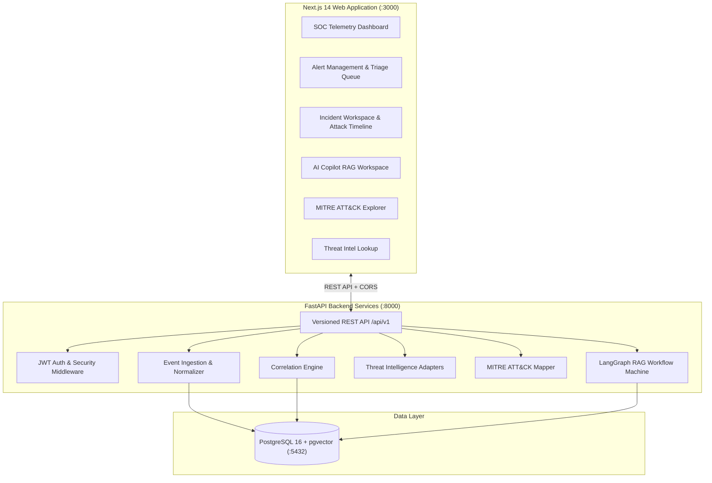

# AI SOC Copilot - Enterprise Autonomous Threat Triage & RAG System

[](https://fastapi.tiangolo.com)
[](https://nextjs.org)
[](https://github.com/pgvector/pgvector)
[](backend/tests)
[](backend/eval/eval_benchmark.py)

---

## 1. What is AI SOC Copilot?

**AI SOC Copilot** is a production-oriented, evidence-grounded Security Operations Center (SOC) Copilot. It ingests heterogeneous security logs (EDR, Firewall, Identity, DNS), normalizes them to a Common Security Event Schema, correlates multi-stage attack chains, enriches indicators with threat intelligence, maps observed behaviors to the **MITRE ATT&CK Framework**, and enables AI-guided security investigations grounded in retrieved evidence (RAG) with complete analyst auditability.

### Key Capabilities
- **Multi-Source Event Ingestion**: Parses and normalizes security events across EDR, Network Firewall, Identity Provider, and DNS telemetry.
- **Rule & Time-Window Correlation Engine**: Automatically groups related alerts by target asset/user within configurable time windows to synthesize cohesive Security Incidents.
- **LangGraph RAG State Machine**: Executes stateful 5-node investigation workflows (Query Understanding → Evidence Retrieval → Context Filtering → MITRE Mapping → Evidence-Grounded Response).
- **Evidence Citation & Confidence Scoring**: Every AI recommendation cites explicit event logs, knowledge base playbooks, and threat intelligence records with relevance scores.
- **MITRE ATT&CK Matrix Mapping**: Maps command lines, hashes, and network traffic to ATT&CK tactics (e.g., T1059.001 PowerShell, T1003.001 LSASS dumping, T1071.001 C2 Web Protocols).
- **Analyst Action & Audit Trail**: Enables analysts to execute host isolation or credential reset playbooks with audit logging.
- **Modern Dark-Theme Web UI**: Responsive Next.js 14 App Router layout with a fixed left navigation sidebar, clean right-hand workspace, visual attack chain timeline, and 1-click synthetic attack simulator.

---

## 2. High-Level System Architecture



---

## 3. Why Docker?

Running an enterprise security AI copilot requires coordinating multiple interdependent infrastructure services:
1. **PostgreSQL with `pgvector` extension** (`pgvector/pgvector:pg16`): Handles relational alert/incident tables as well as high-dimensional vector embeddings for RAG retrieval.
2. **FastAPI Backend Service**: Runs event ingestion pipelines, correlation algorithms, and LangGraph state machines.
3. **Next.js 14 Frontend Web Application**: Serves the web interface, timeline visualizations, and real-time triage controls.

### Advantages of Docker Compose
- **Zero Configuration Setup**: Starts PostgreSQL with `pgvector`, initializes database tables, compiles the Next.js app, and spins up the FastAPI server with a single command.
- **Environment Parity**: Eliminates local environment mismatches (Python dependencies, Node versions, PostgreSQL C-extensions).
- **Network Isolation**: Secure internal container networking allowing `frontend` → `backend` → `db` communication without exposing internal ports.

---

## 4. Running with Docker Compose

### Step 1: Start the System
From the project root directory, run:

```bash
docker-compose up --build
```

Docker will build the backend and frontend containers, pull PostgreSQL with `pgvector`, wait for database healthchecks, and launch all services.

### Access Endpoints
- 🌐 **Frontend Web Application**: [http://localhost:3000](http://localhost:3000)
- ⚙️ **Backend REST API**: [http://localhost:8000/api/v1](http://localhost:8000/api/v1)
- 📖 **Interactive OpenAPI (Swagger) Docs**: [http://localhost:8000/api/v1/docs](http://localhost:8000/api/v1/docs)

---

## 5. Step-by-Step User Walkthrough & How to Use

Follow this step-by-step walkthrough to perform an end-to-end security investigation:

### Step 1: Access the SOC Dashboard
Navigate to [http://localhost:3000](http://localhost:3000). You will see the main layout with:
- **Left Sidebar**: Module navigation links (`SOC Dashboard`, `Alert Triage`, `Incidents Workspace`, `AI Copilot RAG`, `MITRE ATT&CK`, `Threat Intel Lookup`, `Knowledge & Audit`).
- **Header**: Live telemetry status (`SOC Telemetry: Active`) and quick action buttons.
- **Main Area**: Security Telemetry metrics (Normalized Events velocity, Active Alerts count, Correlated Incidents, Mean Time to Respond), Alert Severity Breakdown, and Urgent Security Alerts Queue.

### Step 2: Inject a Synthetic Attack Scenario
Click the **"Simulate Attack Scenario"** (or **"Ingest Attack Scenario"**) button in the top right header.
- **What Happens**: The backend generates a multi-stage attack sequence:
  1. *Phishing Email Delivery* (Link: `http://phish-payroll-update.net/login.php`)
  2. *Encoded PowerShell Execution* (`powershell.exe -Enc ...` spawned by `WINWORD.EXE`)
  3. *LSASS Credential Dump* (`rundll32.exe comsvcs.dll MiniDump` targeting `lsass.exe`)
  4. *Outbound TLS C2 Beaconing* (Connection to `198.51.100.44:443`)
- The correlation engine automatically links these alerts to asset **`WORKSTATION-089`** and aggregates them into a **Critical Incident**.

### Step 3: Triage Alerts in the Alert Queue
Navigate to **Alert Triage** (`/alerts`) via the left sidebar:
- **Filter**: Filter by Severity (`Critical`, `High`, `Medium`, `Low`) or Source (`EDR`, `Firewall`, `Identity`, `DNS`).
- **Update Status**: Change an alert's status dropdown (e.g. `New` → `Acknowledged` → `Investigating`).
- **Inspect Details**: Click **"Details"** on any alert to view the detection rule name, target host, and multi-source correlation reason.
- **Launch AI Triage**: Click **"AI Triage"** to jump directly into the AI Copilot RAG interface with pre-loaded alert query context.

### Step 4: Investigate Attack Chains in the Incident Workspace
Navigate to **Incidents Workspace** (`/incidents`):
- **Visual Attack Timeline**: Trace chronological events from initial phishing delivery through command execution to LSASS dumping and C2 beaconing.
- **Indicators of Compromise (IOCs)**: View linked malicious IPs (`198.51.100.44`) and domains (`c2-command-node.ru`).
- **Execute Containment Actions**: Under **Analyst Response Playbook**, click **"Execute Containment"** (e.g., *Isolate WORKSTATION-089 from Network* or *Reset User Credentials*) with audit logging.

### Step 5: Query the Evidence-Grounded AI Copilot
Navigate to **AI Copilot RAG** (`/copilot`):
- **Ask Natural Language Questions**: Type custom queries or select preset prompts (e.g., *"Explain LSASS memory dump alert on WORKSTATION-089 and give containment steps"*).
- **Review RAG Investigation Output**:
  - **Executive Summary & Key Findings**: High-level incident synthesis.
  - **Mapped MITRE Techniques**: Technique codes (e.g., `T1059.001`, `T1003.001`, `T1071.001`) with raw evidence snippets.
  - **Grounded Evidence Citations**: Direct links to raw log event IDs, threat intel scores, and vectorized playbook chunks with relevance scores.
  - **Confidence Level**: Overall confidence calculation.
- **Provide Feedback**: Click **Useful** or **Needs Improvement** to log analyst feedback.

### Step 6: Explore MITRE Matrix & Threat Intel Lookup
- **MITRE ATT&CK Matrix** (`/mitre`): View tactics columns (*Initial Access*, *Execution*, *Persistence*, *Credential Access*, *C2*) with color-coded severity badges for observed techniques.
- **Threat Intel Lookup** (`/indicators`): Search IP addresses, domains, or file hashes to view VirusTotal/OTX risk scores, threat actor attributions, and raw enrichment feeds.

---

## 6. Post-Docker Operations & Manual Tasks Guide

### What Happens Automatically on Container Startup?
- **Database Initialization**: On startup, FastAPI runs lifespan hooks (`app/core/init_db.py`) that create all SQL tables and seed default admin/analyst user credentials.
- **Default Database Connection**: Automatically connects to the PostgreSQL container at `postgresql://ai_soc_user:12410279@db:5432/ai_soc_db`.

---

### What Needs to Be Done / Run Manually?

#### A. Running Backend Unit & Integration Tests
To execute the Pytest suite manually outside Docker:
```bash
# Ensure Python dependencies are installed in backend
pip install -r backend/requirements.txt

# Run test suite
pytest backend/tests
```
*Expected Output*: `16 passed`

#### B. Running Quantitative Evaluation Benchmark
To run the ground-truth benchmark suite evaluating investigation latency, alert triage F1, correlation F1, and MITRE mapping accuracy:
```bash
python backend/eval/eval_benchmark.py
```
*Expected Output*: Benchmarking report JSON with **1.0 F1 score** and **~440ms latency improvement**.

#### C. Local Development Without Docker (Optional)
If you prefer running components individually without Docker:

1. **Start Backend**:
   ```bash
   cd backend
   uvicorn app.main:app --reload --port 8000
   ```
2. **Start Frontend**:
   ```bash
   cd frontend
   npm run dev
   ```

---

## 7. Project Directory Structure

```
ai-soc-copilot/
├── backend/
│   ├── app/
│   │   ├── api/endpoints/   # Auth, Alerts, Incidents, Copilot, MITRE, Indicators, Feedback
│   │   ├── core/            # Config, DB connection, JWT auth, logging
│   │   ├── models/          # SQLAlchemy ORM models (Event, Alert, Incident, Indicator, Knowledge)
│   │   ├── schemas/         # Pydantic V2 validation schemas
│   │   ├── services/        # Ingestion, Correlation, ThreatIntel, Vector, RAG, LangGraph
│   │   └── main.py          # FastAPI application entrypoint
│   ├── eval/                # Quantitative benchmark script & dataset
│   ├── tests/               # Pytest integration suite
│   ├── Dockerfile           # Backend container build script
│   └── requirements.txt
├── frontend/
│   ├── src/
│   │   ├── app/             # Next.js 14 App Router pages (Dashboard, Alerts, Incidents, Copilot, MITRE, Intel)
│   │   ├── components/      # UI components (Navigation, Badges, StatCards)
│   │   ├── lib/             # API client & fallback simulation engine
│   │   └── styles/          # Tailwind CSS design system tokens
│   ├── Dockerfile           # Next.js multi-stage build script
│   └── package.json
├── docker-compose.yml       # Orchestration manifest
├── .env.example
└── README.md
```