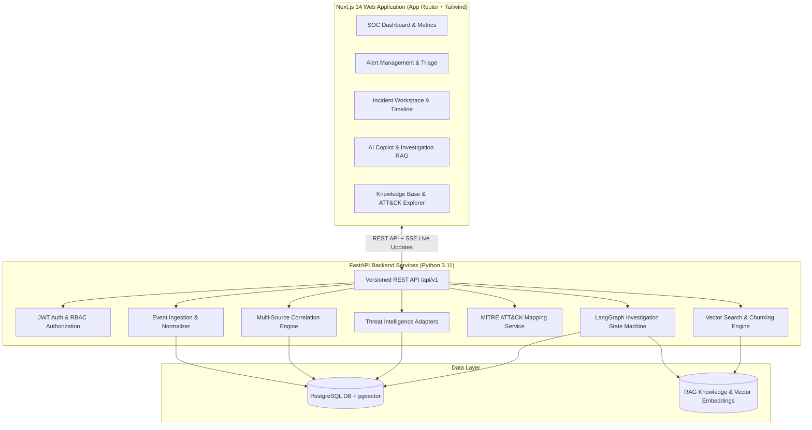

# AI SOC Copilot - System Architecture & Implementation Plan

## 1. System Overview
**AI SOC Copilot** is a production-oriented, evidence-grounded Security Operations Center (SOC) Copilot. It ingests heterogenous security logs, normalizes them to a Common Security Event Schema, detects & correlates related security events, enriches indicators with threat intelligence, maps observed behavior to the MITRE ATT&CK framework, and enables AI-assisted investigation grounded in retrieved evidence (RAG) with complete analyst auditability.

---

## 2. High-Level Architecture Diagram



---

## 3. Data Flow & Security Pipeline

1. **Ingestion & Normalization**: Security logs (JSON/JSONL/CSV) are parsed, validated, normalized to Common Event Schema (`event_id`, `timestamp`, `source`, `event_type`, `severity`, `src_ip`, `dst_ip`, `user`, `process_name`, `command_line`, `raw_data`), and stored.
2. **Correlation Engine**: Evaluates ingested events against rule & time-window criteria (e.g. host identity matching, credential access chains) and aggregates them into **Alerts** and **Incidents**.
3. **Threat Intelligence Enrichment**: Indicator values (IPs, domains, hashes) are extracted and queried through enrichment adapters (VirusTotal/OTX mock/external) with cached confidence and provenance.
4. **LangGraph Investigation Workflow**:
   - **Node 1: Query Understanding**: Extracts intent, target entities, and timeframe.
   - **Node 2: Evidence Retrieval**: Queries relational database and pgvector store for relevant events & approved playbooks.
   - **Node 3: Context Assembly**: Filters by user permissions, cleans content, guards against prompt injection.
   - **Node 4: Analysis & MITRE Mapping**: Maps evidence against MITRE ATT&CK tactics/techniques with explicit rationale.
   - **Node 5: Response Generation**: Generates structured summary, cited evidence references, confidence level, limitations, and analyst recommendations.
5. **Analyst Review & Audit**: Analyst validates recommendations, executes response actions (with approval records), and provides feedback.

---

## 4. Folder Structure

```
ai-soc-copilot/
├── backend/
│   ├── app/
│   │   ├── core/           # Config, database, security JWT, logging, dependencies
│   │   ├── models/         # SQLAlchemy ORM models (User, Event, Alert, Incident, Indicator, Knowledge, Audit)
│   │   ├── schemas/        # Pydantic schemas (V2) for validation
│   │   ├── api/            # FastAPI endpoints (/auth, /dashboard, /alerts, /incidents, /copilot, /mitre, etc.)
│   │   ├── services/       # Core logic (Ingestion, Correlation, ThreatIntel, Vector, RAG, LangGraph)
│   │   └── data/           # Seed playbooks and MITRE ATT&CK reference data
│   ├── alembic/            # Migration scripts
│   ├── tests/              # Pytest test suite
│   ├── eval/               # Quantitative benchmark scripts & dataset
│   └── requirements.txt
├── frontend/
│   ├── src/
│   │   ├── app/            # App router pages (dashboard, alerts, incidents, copilot, knowledge, mitre)
│   │   ├── components/     # UI components (charts, badges, tables, timeline, chat)
│   │   ├── lib/            # API client, types, auth utilities
│   │   └── styles/         # CSS design system & Tailwind tokens
│   └── package.json
├── docker-compose.yml
├── .env.example
└── README.md
```

---

## 5. Milestone & Phase Checklist

- [x] **Phase 1**: Inspection, System Architecture, Folder Structure, Environment Setup.
- [x] **Phase 2**: Backend Database Models, Alembic Migrations, JWT Auth, Security Middleware.
- [x] **Phase 3**: Event Ingestion Pipeline, Schema Normalization, Alert Management API & Synthetic Data.
- [x] **Phase 4**: Correlation Engine, Incident Management, Indicator Extraction & Threat Intel Adapters.
- [x] **Phase 5**: Knowledge Base RAG Ingestion, Chunking, Vector Retrieval (pgvector) & LangGraph Workflow.
- [x] **Phase 6**: MITRE ATT&CK Mapping Engine, Recommendations, Analyst Feedback & Audit Logging.
- [x] **Phase 7**: Modern Next.js Frontend Dashboard, Incident Workspace, Copilot Interface & SSE Live Updates.
- [x] **Phase 8**: Security Hardening, Pytest Suite, Evaluation Benchmark Script, Docker Compose setup.
- [x] **Phase 9**: Final E2E Validation, Verification, and Documentation.
